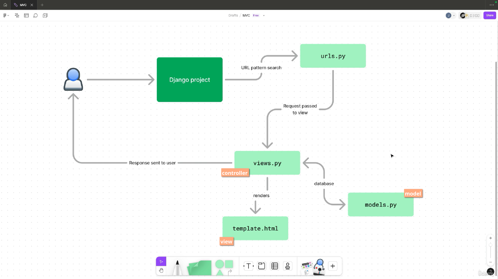

# Full Stack Web Development with Django 5, TailwindCSS, HTMX

### TODO & TASKS:

* [o] well, then show me to: how to configure cloudlfare
* [o] now the issue is, my VPS (linx server) got multiple interfaces (lan-1, lan-2, global, internet, tailscale, vpn, etc...) -- how to configure ufw so that it opens the necessary 443 port on all interfaces at once? Or is it configured for each interface one by one?


* > [>] My nginx version: nginx/1.30.4
    * -> **VPS depoyment:**
        ```
        /etc/dev/
        ├── gateway/                   <-- Central Gateway Stack
        │   ├── compose.yaml           <-- Runs Nginx & Certbot
        │   └── nginx/
        │       └── conf.d/            <-- Contains all site .conf files
        │
        ├── my-blog-app/              <-- Blog Stack
        │   └── compose.yaml           <-- Runs Django & Postgres
        └── my-shop-api/              <-- Shop Stack
            └── compose.yaml           <-- Runs FastAPI & Redis
        ```
    -------
    * ```Worth knowing: Docker writes its own iptables rules and can bypass ufw for published ports. Don't rely on ufw alone to keep something private — the real protection below is that only nginx publishes ports at all.``` --  what the?! HOW THE HECK I KNOW what ports & services are open/running in VPS??? Or I mean, can't tell whether docker is opening & using any port without telling me?!
    * Does nginx handle multiple conf files in conf.d or should I write them into one?
    * I might 5-10 (or sometimtes even more!) websites/apps/containers/domains/APIs/services & etc...???
    * Using nginx as web server, reverse proxy, API gateway & even load balancer!?
    * Using NGINX with or within docker compose -- properly & professionally?
    * NGINX: make port 80 is only redirect -> to 443 (tls -> HTTP`S`), so https://my-app.com/api/get-users -> will work fine (might return json or so), but http version of it won't (give the response or any data) & might redirect to https page instead!

    * But how supposed to use nginx when I'm running & deploying all apps & services in docker (compose)? Doesn't multiple nginx containers/services from different apps/composes/dockerfiles -- run at the same time &/ conflict? I mean, using nginx in docker without manually installing or configuring nginx but via docker? How to save & persist nginx then...
    * I have zero knowledge of nginx & using & configuring it, confused by it?! (and also using/configuring it with compose!)
    * which nginx (stable) image to use (& why)?
        * -> **`nginx:1.30-alpine`**
        - alpine-otel
        - alpine-perl
        - alpine-slim
        - alpine
        - debian-otel
        - debian-perl
        - debian
        - trixie-otel
        - trixie-perl
        - trixie-slim
        - trixie
        - ???
    - nginx:1.30-trixie


* CURRENT config of VPS in /etc/ssh/sshd_config >>>
    ```
    PermitRootLogin prohibit-password
    #PasswordAuthentication yes
    ```
    ???
    So that I can conveniently login to that from my host linux like this: $ `ssh private-server`, and why you're saying this?!
    ```# /etc/ssh/sshd_config
    PasswordAuthentication no
    PermitRootLogin no```???
* Deploying web app to VPS (custom domain + cloudflare dns only + nginx web server): unfortunately ports 443 & 80 will be open to public, but in that vps 22 is also open for ssh??? That's the thing makes concerning?
* Should I change ssh service port from default 22 to something random like 8443?
* But why ssh root access should be disabled... What's the difference hackers easily become root with the password of any user in linux with a command like sudo su --- once they found the user password?

* what does it look like & usage & working: making docker client in my personal PC and docker server in VPS? so that I can control docker containers in my PC or it would be better to use/work via ssh (e.g. tmux) in VPS instead?
    * **ANSWER:** The strongest version of this, though, is neither: don't build on the VPS at all. Build images in CI (GitHub Actions etc.), push to a registry, and have the VPS only ever docker compose pull && docker compose up -d. That sidesteps the build-context upload problem entirely, gives you versioned artifacts you can roll back to, and means the VPS needs no source code on it at all — which leads directly into your second question.

* Setup NGINX web server -> docker.
* Learn: Docker (compose) Secrets/Credentials

---

* NOTE: although the course taught `django v5`, this repo used `django v6.0.3`, look for `pyproject.toml` for more about packages & dependencies.
* Create the project environment:
    ```bash
    uv init --name DjangoBlog --no-package --no-workspace --vcs none
    uv add django
    uv venv --prompt DjProject
    uv sync --all-packages
    uv lock
    ```
* Building & Running Docker Container:
    1. `docker build -t djangoblog .`
    2. `docker run --rm -p 8005:8000 --name djangoblog djangoblog`
        * Run Docker Container with Volumes: `docker run --rm -p 8005:8000 --name djangoblog -v "$(pwd):/code" djangoblog`
    3. `docker exec djangoblog uv run manage.py makemigrations`
        * `docker exec djangoblog uv run manage.py migrate`

- Adding translations:
    - `$ docker exec djangoblog uv run manage.py makemessages  --locale=uz `
    - `$ docker exec djangoblog uv run manage.py compilemessages`
- Docker compose commands:
    - Completely recreate the docker image: `docker compose up --build --force-recreate --no-deps <service_name>`
---

## Django Course Notes:

* Architecture of the Django Framework: 
* Starting/Creating a new django project: **`$ uv run django-admin startproject <projectname> . `**
* To start the application: **`$ uv run manage.py runserver`**
    * *Ctrl+C* to stop the server.
* Run & apply migrations: **`$ uv run manage.py migrate`**
* Create a superuser: **`$ uv run manage.py createsuperuser`**
* Access the admin panel: `/admin` (http://127.0.0.1:8000/admin)
* Create django app: **`$ uv run manage.py startapp <appname>`**
* Create migrations (for db): **`$ uv run manage.py makemigrations`**
* Create custom migration: **`$ uv run manage.py makemigrations --empty <appname>`**
* Django automatically escapes the HTML content, we can turn it off in templates using `{{ content | safe }}`.
* Django has built-in command `check --deploy` for security checks: **`uv run manage.py check --deploy`**
*
---

* Difference between `<strong>` vs `<b>`, `<em>` vs `<i>`?
    * `<b>` is just for styling (making it bold), `<strong>` for also style AND meant for that the content is particularly important in the page.
* **Browser Cookie** (a.k.a. HTTP cookie) -- a small block of data created by a web server while a user is browsing a website and placed on the user's computer or other device by the user's web browser. \
https://en.wikipedia.org/wiki/HTTP_cookie
* **CSRF** (Cross-Site Request Forgery / **XSRF**) is an attack that forces an end user to execute unwanted actions on a web application in which they’re currently authenticated. \
https://owasp.org/www-community/attacks/csrf \
https://en.wikipedia.org/wiki/Cross-site_request_forgery
* `POST`, `PUT` and `DELETE` methods are known as "unsafe", which means we should use CSRF protection on them. Other methods are "safe".
* Preventing CSRF attack:
    1. CSRF tokens -- server-generated secret code that must be present in the form.
    2. SameSite cookies -- cookies are not sent from third party sites on form submissions. (This is now default in most browsers)

---

### Docker

* You can run a command inside a running container with `docker exec`. There's no need to open an interactive shell — you can pass the command directly. \
This lists the files nginx is serving. The `index.html` you just saw (by running nginx service) in the browser is right there inside the container's filesystem:
    ```bash
    docker exec my-nginx ls /usr/share/nginx/html
    ```
* This prints the nginx config file from inside the container. No SSH, no VM — just `docker exec`:
    ```bash
    docker exec my-nginx cat /etc/nginx/nginx.conf
    ```
* `docker exec` runs a one-off command in a running container. For interactive debugging you can also do `docker exec -it my-nginx bash` to open a full shell session, but passing commands directly is often faster for quick inspections.

* **Docker Best Practices**:
    * *Layer management*:
        * Combine `apt-get install` and `rm -rf /var/lib/apt/lists/*` in a single `RUN`
        * Combine install and cleanup of any temporary files in the same `RUN` step
    * *Build cache efficiency*:
        * Copy dependency manifests (`requirements.txt`, `package.json`) before source code
        * Use `--no-cache-dir` (`pip`) or equivalent to avoid writing unnecessary cache to layers
        * Keep a `.dockerignore` that excludes `.git`, caches, test files, and local config
    * *Security*:
        * Never use `ARG` or `ENV` to pass secrets — use `--mount=type=secret` instead
        * Run the app process as a non-root user (`USER nobody` or a dedicated app user)
        * Use a minimal base image for production (`python:*-slim`, `python:*-alpine`, or Docker Hardened Images at `dhi.io`)
    * *Multi-stage builds*:
        * Run tests in a build stage — fail fast if tests break
        * Use a minimal base image in the production stage
        * Only copy what the runtime needs into the final stage (source code, installed packages)

* **Docker Compose:**
    * sample `compose.yaml` file:
        ```yaml
        include:
        - path: ./infra.yaml

        services:

        web:
            build: .
            ports:
            - "${APP_PORT:-8000}:5000"
            environment:
            - REDIS_HOST=${REDIS_HOST:-redis}
            - REDIS_PORT=${REDIS_PORT:-6379}
            depends_on:
            redis:
                condition: service_healthy
            develop:
            watch:
                - action: sync+restart
                path: .
                target: /code
                ignore:
                    - requirements.txt
                - action: rebuild
                path: requirements.txt
        ```
    
    * multiple compose files: `infra.yaml`
        ```yaml
        services:
        redis:
            image: redis:alpine
            volumes:
            - redis-data:/data
            healthcheck:
            test: ["CMD", "redis-cli", "ping"]
            interval: 5s
            timeout: 3s
            retries: 5
            start_period: 10s

        volumes:
        redis-data:
        ```
    * Compose automatically loads variables from your `.env` file. The `${VAR:-default}` syntax uses the value from `.env` if present, otherwise falls back to the hardcoded default. This lets you override settings without modifying the Compose file.
